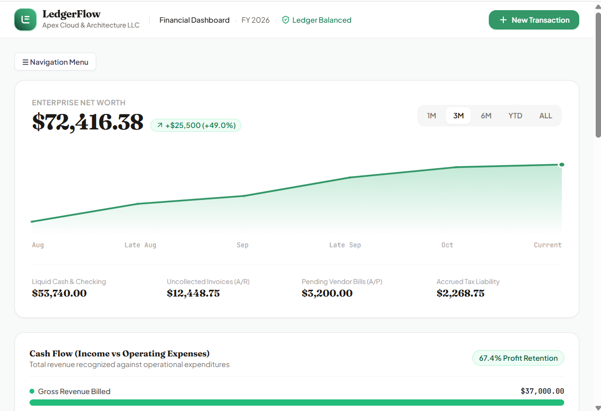
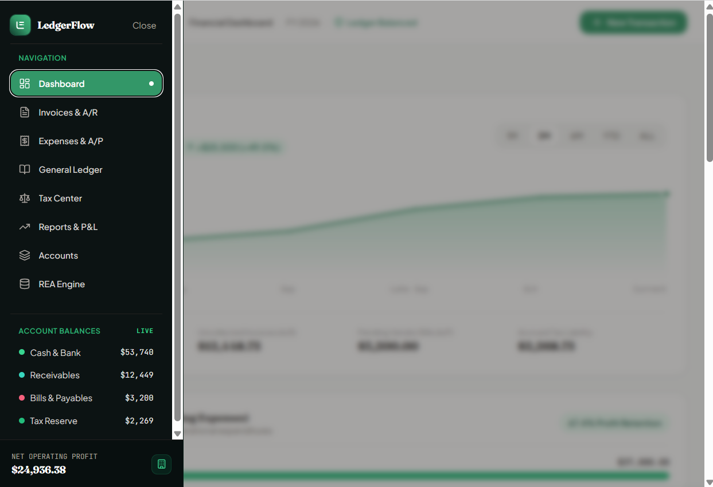

# LedgerFlow

A double-entry accounting and tax tool. Every transaction posts a balanced
journal entry, and the financial statements are derived from those entries
rather than stored separately.



## Why it exists

Small organisations get sold accounting software priced for companies ten times
their size, and most of what they pay for is the posting engine underneath. That
engine is not complicated. It is a ledger where debits equal credits, and a set
of reports that read from it.

LedgerFlow is that engine, built so the accounting is visible instead of hidden
behind a wizard. Every invoice, expense and tax payment produces a journal entry
you can open and inspect.

## Architecture

The whole application runs in the browser. There is no backend, no database and
no network call. State lives in React context and persists to `localStorage`
under six keys: accounts, invoices, expenses, journal, tax and REA.

### The posting model

`src/types/accounting.ts` defines the ledger. The core shape is a `JournalEntry`
holding a list of `JournalLine` records, each carrying a `debit` and a `credit`
against one account. An entry is valid when the two sides sum equal. The
"Ledger Balanced" indicator in the header is that check running live.

Five account types drive the statements:

| Type | Statement |
| --- | --- |
| `ASSET`, `LIABILITY`, `EQUITY` | Balance sheet |
| `REVENUE`, `EXPENSE` | Profit and loss |

Account balances are never written directly. They are computed by walking the
journal, so a report and the ledger cannot disagree.

### The REA layer

Alongside the journal, the app models the same activity as Resources, Events and
Agents. A sale is one economic event that decrements a service resource and
increments a receivable, linked to its opposite through `dualEventId`. Each REA
event carries a `journalEntryId` back to the double-entry record.

This is the accounting-theory view of the same facts. It is in here because it
makes the question "what actually happened" separable from "how was it booked",
which is the part conventional software hides. The REA Engine view renders it.

### Tax tracking

Expenses carry a `taxDeductibility` flag of `100_PERCENT`, `50_PERCENT_MEALS`,
`CAPITALIZED` or `NON_DEDUCTIBLE`, plus a `isContractor1099` marker.
`QuarterlyTaxSummary` rolls these up into sales tax collected against sales tax
paid, then estimates federal, state and self-employment liability for the
quarter.

The estimates are arithmetic on the ledger. They are not tax advice and they are
not filed anywhere.

## The eight views



| View | What it does |
| --- | --- |
| Dashboard | Net worth trend, cash flow, and the four live balances |
| Invoices & A/R | Issue invoices, record payment, watch receivables |
| Expenses & A/P | Record bills with deductibility and 1099 flags |
| General Ledger | Every journal entry, both sides, filterable |
| Tax Center | Quarterly rollups and estimated liability |
| Reports & P&L | Statements derived from the journal |
| Accounts | The chart of accounts |
| REA Engine | Resources, events and agents, with duality links |

## Running it

```bash
npm install
npm run dev
```

Opens on port 3000. `npm run lint` runs `tsc --noEmit`, which is the only check
in the repo at the moment.

## Honest status

This is a working build, not a shipped product. Specifics worth knowing:

- **The data is fictional.** It seeds from `src/data/sampleData.ts` with a made-up
  company, Apex Cloud & Architecture LLC, and made-up customers. No real financial
  record of any person or client is in this repository.
- **No AI runs in it.** `package.json` carries `@google/genai` and `metadata.json`
  declares a Gemini capability, both left over from the AI Studio scaffold it was
  started from. Nothing in `src/` calls either. The dependency should come out.
- **`localStorage` is the only persistence.** Clearing site data clears the books.
  There is a backup and restore modal that exports JSON, and that is the whole
  durability story right now.
- **No tests.** Type checking is the only automated check.
- **Multi-currency is declared but not implemented.** `CompanyProfile` has a
  `currency` field and everything assumes USD.

## Licence

No licence is granted. This repository is published so the architecture can be
read, not reused.
